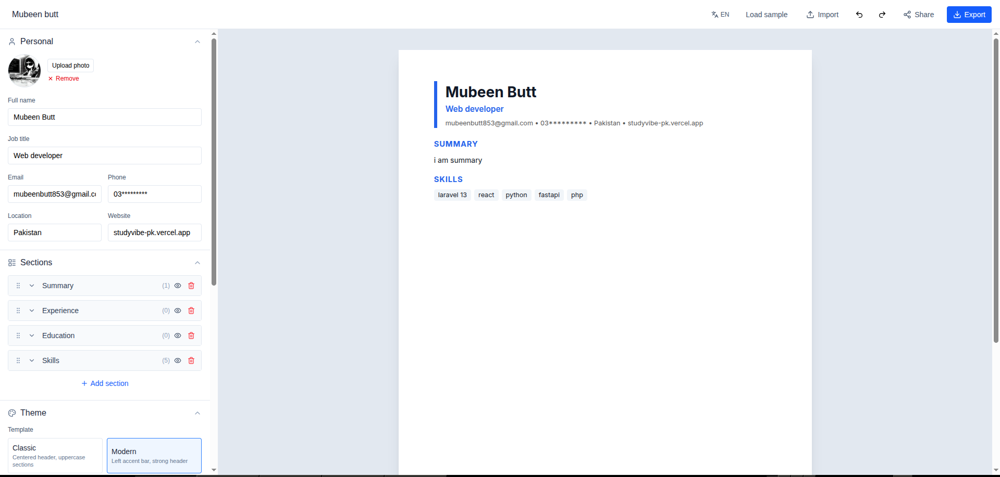
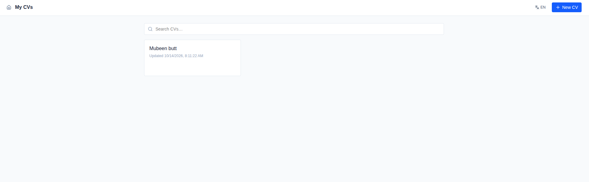

# CV Maker

**Free, open-source, privacy-first CV builder that runs entirely in your browser.**

No signup. No backend. Your data never leaves your device.

## Why

Most CV builders want your email, hide PDF export behind a paywall, or upload your data to a server you don't control. CV Maker is the opposite:

- **100% client-side** — everything runs in your browser
- **No accounts** — nothing to sign up for
- **No tracking** — no analytics, no ads
- **Portable** — export a `.cv.json` project file, re-import anytime
- **Deployable anywhere static** — Vercel, Netlify, GitHub Pages

## Screenshots

<!--
TODO: add screenshots here, e.g.


-->

_Coming soon._

## Features

### Editor
- Live A4 preview as you type
- Sections: summary, experience, education, skills, projects, languages, certifications, awards, volunteering, custom
- Add / rename / delete / reorder sections and items with drag & drop
- Section visibility toggles
- Undo / redo (50 steps)
- Autosave + auto-save toast

### Templates & Design
- 5 templates: Classic, Modern, Minimal, Two-Column, ATS Plain
- Accent color picker
- Google Fonts selector (Inter, Roboto, Lora, Merriweather, Source Sans 3, Playfair Display)
- Font size, line height, section spacing sliders
- Photo upload with show/hide toggle
- Adjustable print margin

### Export & Import
- **PDF** via browser print (proper `@page` margin, no cut-off)
- **`.cv.json`** project file — re-openable, portable, human-readable
- **HTML** — self-contained, printable, with embedded JSON
- **Import** from file picker or drag-and-drop onto the editor
- **Share via URL** — compressed state in the hash (`#cv=...`), no server needed

### Storage & Multi-CV
- Multiple CVs stored in IndexedDB (via Dexie)
- Dashboard with search, duplicate, delete
- localStorage mirror for the active CV

### i18n
- English + Arabic UI
- Full RTL layout when Arabic is selected
- CV direction controlled independently via `settings.rtl`

### Keyboard Shortcuts
Full keyboard shortcut support — see the [Keyboard Shortcuts](#keyboard-shortcuts) table below.

### Privacy
- No backend
- No analytics
- No external API calls at runtime (fonts are loaded from Google Fonts only when a font is selected)

## Tech Stack

- **Vite + React 19 + TypeScript**
- **Tailwind CSS v4** (`@tailwindcss/vite`)
- **Zustand** — state, undo/redo, persistence
- **Dexie** — IndexedDB wrapper for multi-CV storage
- **dnd-kit** — drag & drop
- **react-router-dom** — pages
- **lucide-react** — icons
- **lz-string** — share-via-URL compression

## Getting Started

```bash
git clone <your-repo-url>
cd cv-maker
npm install
npm run dev
```

Then open `http://localhost:5173` in your browser.

**Building for production**

```bash
npm run build
```

Outputs a static site to `dist/`.

**Deploy to Vercel**

Import your GitHub repo into Vercel — the Vite preset is auto-detected and no environment variables are needed. Any static host (Netlify, GitHub Pages) works too.

## Keyboard Shortcuts

| Shortcut | Action |
|---|---|
| `Ctrl/Cmd + S` | Save `.cv.json` |
| `Ctrl/Cmd + P` | Print / Export PDF |
| `Ctrl/Cmd + Z` | Undo |
| `Ctrl/Cmd + Shift + Z` | Redo |
| `Ctrl/Cmd + K` | Command palette |
| `Ctrl/Cmd + E` | Go to dashboard |

## Project Structure

```
src/
  components/
    editor/     Topbar, Sidebar, PersonalForm, SectionsEditor, ThemeEditor,
                ItemEditorDispatcher, SummaryEditor, ExperienceEditor, EducationEditor,
                SkillsEditor, ProjectsEditor, LanguagesEditor, CertificationsEditor,
                AwardsEditor, VolunteeringEditor, CustomItemsEditor
    preview/    PreviewPane
    ui/         Fields, Sortable, CommandPalette, LangSwitcher, SaveToast
  pages/        LandingPage, DashboardPage, EditorPage
  store/        cvStore.ts (Zustand with undo/redo + IndexedDB mirror)
  hooks/        useI18n, useKeyboardShortcuts, useUnsavedWarning
  templates/    index.ts (registry), shared.tsx, Classic, Modern, Minimal, TwoColumn, AtsPlain
  lib/          cvFactory, db (Dexie), io (export/import), share (lz-string), i18n (dict)
  types/        cv.ts (CV, CVSection, SectionType, Personal, CVTheme, CVSettings, all item types)
```

## Roadmap

- [ ] ATS score checker
- [ ] Job-description keyword match
- [ ] Bullet suggestion library
- [ ] PWA / offline support
- [ ] PDF / DOCX import
- [ ] Encrypted exports
- [ ] Optional Google Drive / Gist sync

## Contributing

Contributions are welcome!

1. Fork the repo
2. Create a branch (`git checkout -b feature/my-feature`)
3. Commit your changes
4. Open a Pull Request

Please keep the app frontend-only and run `npm run build` before submitting. See [CONTRIBUTING.md](CONTRIBUTING.md) for details.

## License

MIT — see [LICENSE](LICENSE).

---

Made by **Bobi Butt** — [GitHub](https://github.com/your-username)
